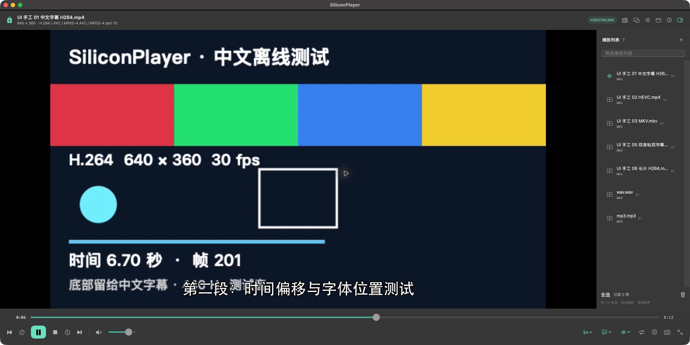

# SiliconPlayer

**为 Apple M 系列 Mac 打造的原生播放器，先把日常播放做好。**

`macOS 14+` · `Apple Silicon / arm64` · `0.6.0 日常版` · `应用约 113 MiB`

SiliconPlayer 希望把 PotPlayer 中常用的播放、字幕、列表与工具能力带到 Mac，界面采用 SwiftUI / AppKit，播放基础复用 mpv、FFmpeg 和 libass。当前版本注重好用、轻量和合理的资源占用，常见操作集中在一个窗口中。



*实际运行界面：播放画面、进度控制与播放列表。*

[功能与使用](Docs/OVERVIEW.md) · [测试与资源实测](Docs/TESTING.md) · [开发说明](Docs/BUILDING.md)

## 当前发布内容

当前先公开**源码、图文说明与测试摘要**。本地日常成品已经完成构建与测试，应用约 113 MiB；公共二进制发行还需要完成依赖许可与对应源码材料归档。

开发构建仅支持 M 系列 Mac，最低目标 macOS 14。在受控依赖准备完成后，可以运行：

```bash
SILICONPLAYER_BUILD_PROFILE=core bash scripts/build_app.sh
```

完整前置条件和当前复现边界见 [开发说明](Docs/BUILDING.md)。当前公开源码仓库没有提供成品下载，也没有宣称已完成 Apple 公证或 App Store 发布。

## 日常功能

| 场景 | 已提供的能力 |
| --- | --- |
| 看视频、听音频 | 本地文件与直接网络地址；H.264、HEVC、MKV、MOV、MP4 和常见音频；VideoToolbox 硬件解码 |
| 快速控制 | 精确跳转、逐帧、倍速、A–B 循环、单文件循环、音量与静音、全屏、系统画中画 |
| 整理播放 | 列表筛选、多选、批量移除、右键排序、列表导入导出、历史续播、书签与收藏 |
| 看字幕、选音轨 | 多音轨、外部音轨、ASS/SRT 主副字幕、独立样式与同步设置 |
| 调整画面与声音 | 常用画面设置、用户滤镜、十段均衡器与输出设备选择 |
| 保存与导出 | PNG/JPEG/WebP 截图、剪贴板、手动缩略图与拼图、MP4 片段、原码片段复制、完整 WAV 音频 |


*实际视频截图输出：自制测试素材上的中文字幕，包含两行文字。*

WAV 导出保留输入采样率与声道，输出 16 位 PCM，使用 FFmpeg 默认源音轨选择。它导出完整音频，片段起止时间不用于 WAV；不保证跟随播放器当前选择的第二音轨。

## 轻量与实测

日常版不包含语音模型、Deno 或 yt-dlp。时间轴拖动只显示定位时间，不自动启动 FFmpeg 缩略图任务；需要时可从“工具”手动生成。画面滤镜默认关闭。


最终 **core build 13 r3** 通过 **140 个模块检查 + 30 个实际应用场景组**。4K H.264 60fps 约一分钟实测平均 CPU **12.65%**，稳定物理足迹峰值 **359.10 MiB**，解码与渲染均零丢帧。普通界面还实测了三种来源的 WAV 导出、中文字幕截图、启动器窗口复用，以及设置面板打开时的正常退出。

测试设备为 Apple M6 / 16 GB / macOS 27.0.1，使用窗口内 SDR 素材。CPU 100% 约等于一个核心；物理足迹与 RSS 是不同指标。以上数据描述本次测试条件，完整计数、哈希与验证边界见 [测试摘要](Docs/TESTING.md)。

## 常用快捷键

| 快捷键 | 操作 | 快捷键 | 操作 |
| --- | --- | --- | --- |
| 空格 | 播放 / 暂停 | ← / → | 后退 / 前进 5 秒 |
| F / M / V | 全屏 / 静音 / 停止 | [ / ] | 降低 / 提高倍速 |
| . / , | 下一帧 / 上一帧 | A | 设置 / 清除 A–B 循环 |
| ⌘O / ⇧⌘O | 打开 / 添加媒体 | ⌘U | 打开网络地址 |
| ⇧⌘S | 加载字幕 | ⌘S | 截图 |
| ⌘L / ⌘I | 播放列表 / 媒体信息 | ⌘, | 播放设置 |

## 后续方向

先继续打磨日常体验，再逐步完善语音字幕、网页视频解析、Metal/HDR、360°/3D、设备采集、远程协议、光盘菜单与投屏等能力。当前版本没有宣称这些少用能力已经验收，也尚未覆盖 PotPlayer 的全部功能；项目与 PotPlayer 官方无关联。

## 开源基础

- [mpv](https://github.com/mpv-player/mpv)：播放引擎和媒体控制。
- [FFmpeg](https://ffmpeg.org/)：媒体解码、探测与导出。
- [libass](https://github.com/libass/libass)：ASS 字幕渲染。
- [IINA](https://github.com/iina/iina)：原生 Mac 交互参考和最初播放依赖来源。

界面使用 Swift / SwiftUI / AppKit 独立编写。当前仓库公开源码与开发文档，项目整体许可证尚未指定；源码可见不代表已授予新的开源使用许可。第三方代码继续适用各自许可证，已有许可说明随本机成品保留；完整依赖许可、对应源码与构建补丁仍需在公共二进制发行前归档。当前没有宣称整个应用已完成 GPL 兼容性审计。构建依赖与复现边界见 [开发说明](Docs/BUILDING.md)。
