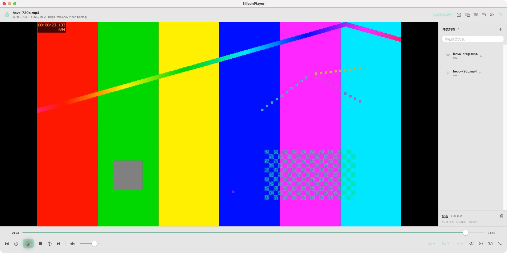
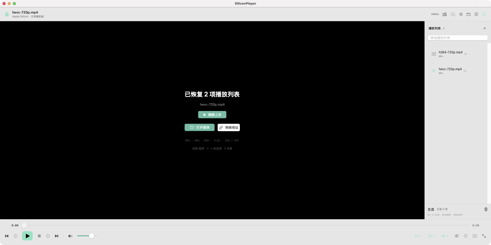
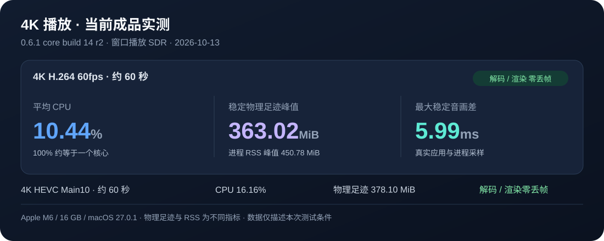

# SiliconPlayer

**Apple Silicon 原生播放器，把日常播放做好。**

`macOS 14+` · `Apple M 系列 / arm64` · `0.6.1 core build 14 r2` · `应用 113.70 MiB`

[下载应用](https://github.com/RGB-hengzhi/SiliconPlayer/releases/download/v0.6.1-core/SiliconPlayer-0.6.1-core-arm64.zip) · [应用源码](https://github.com/RGB-hengzhi/SiliconPlayer/releases/download/v0.6.1-core/SiliconPlayer-0.6.1-core-application-source.zip) · [SHA256SUMS](https://github.com/RGB-hengzhi/SiliconPlayer/releases/download/v0.6.1-core/SHA256SUMS.txt)

*本构建真实界面：继续 HEVC 后暂停，保留当前列表与播放位置。*

## 0.6.1：恢复播放和追加更顺手

| 场景 | 使用方式 |
| --- | --- |
| 重开播放器 | 欢迎页显示“已恢复 N 项播放列表”和上次选中的媒体，点击“继续上次”再从历史位置播放。启动本身不自动加载或播放。 |
| 拖入媒体 | 拖到播放画面替换列表，拖到侧栏追加；侧栏原生行、空列表和筛选无结果入口也已实现。内部行重排保留。 |

*恢复两项列表并显示选中媒体；继续播放需要明确操作。*

真实窗口复测中，点击“继续上次”从约 8.167 秒开始播放；暂停在 23.133 秒后添加 FLAC，列表增至三项，当前媒体、位置与暂停保持。⌘O 打开另一媒体则替换为一项。原生追加回调已测，跨 App 物理鼠标拖动尚未认证，详见 [测试摘要](Docs/TESTING.md)。

## 开始使用

下载约 **48.26 MiB** 的 ZIP，解压并把 `SiliconPlayer.app` 拖到“应用程序”。按 **⌘O** 打开视频或音频，也可拖入文件、多个文件或文件夹。成品自带播放和导出依赖，无需安装 Homebrew、Python、Xcode 或语音模型。

采用 **ad-hoc 签名，尚未完成 Apple 公证**。若首次打开被拦截，核对来源及校验清单后，在“系统设置 → 隐私与安全性”为该应用选择“仍要打开”，再确认“打开”；无需关闭 Gatekeeper。[Apple 官方说明](https://support.apple.com/zh-cn/102445)

## 日常功能与轻量

本地与直接网络媒体，多音轨和外部音轨，ASS/SRT 主副字幕，逐帧、倍速、A–B 循环，全屏与画中画，均衡器，历史、书签和收藏，PNG/JPEG/WebP 截图及片段/WAV 导出。少用的高级能力后续逐步完善，项目与 PotPlayer 官方无关联。

日常版不包含 ASR 模型、Deno 或 yt-dlp；拖动时间轴不自动运行 FFmpeg 缩略图任务，画面滤镜默认关闭。

当前构建通过 **140 个模块检查 + 12 个实际应用场景，共 152 项自动检查**，13 个执行阶段自然退出。4K H.264 60fps 约一分钟实测 CPU 平均 **10.44%**、稳定物理足迹峰值 **363.02 MiB**，解码/渲染零丢帧。设备为 Apple M6 / 16 GB / macOS 27.0.1，窗口内 SDR 播放；CPU 100% 约等于一个核心，物理足迹与 RSS 为不同指标。旧版本成绩未计入本次。

[功能说明](Docs/OVERVIEW.md) · [测试摘要](Docs/TESTING.md) · [开发说明](Docs/BUILDING.md) · [依赖与对应源码](Docs/DEPENDENCIES.md)

| 快捷键 | 操作 | 快捷键 | 操作 |
| --- | --- | --- | --- |
| 空格 | 播放 / 暂停 | ← / → | 后退 / 前进 5 秒 |
| ⌘O / ⇧⌘O | 打开 / 添加媒体 | F / M / V | 全屏 / 静音 / 停止 |
| ⌘S / ⌘, | 截图 / 设置 | [ / ] | 降低 / 提高倍速 |

## 开源基础与许可

界面使用 Swift / SwiftUI / AppKit 编写，播放基础复用 [mpv](https://github.com/mpv-player/mpv)、[FFmpeg](https://ffmpeg.org/) 和 [libass](https://github.com/libass/libass)，参考 [IINA](https://github.com/iina/iina) 的 Mac 原生交互。

原创部分 **Copyright © 2026 RGB-hengzhi (SiliconPlayer)**，采用 **GPL-3.0-or-later**，第三方版权和许可保持不变，见 [LICENSE](LICENSE)、[NOTICE](NOTICE.md) 与 [第三方说明](THIRD_PARTY.md)。新的实际应用源码、构建与打包材料随本次 Release 提供；相同 44 个播放库和两个媒体工具复用 [0.6.0 已公开的依赖对应源码](https://github.com/RGB-hengzhi/SiliconPlayer/releases/download/v0.6.0-core/SiliconPlayer-0.6.0-core-dependency-source.zip)。完整对应源码供给不宣称已经在任意干净机器上完成逐字节重建。
